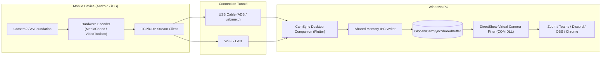

# 📷 CamSync: Open-Source High-Performance Webcam System
> Turn any Android or iOS phone into an ultra-low latency, studio-grade webcam for Windows PC.  
> **100% Free • Open Source • No Paywalls • No Watermarks • No Lag**

[](https://github.com/ramsforge/CamSync/actions/workflows/build-and-release.yml)
[](https://github.com/ramsforge/CamSync/releases)
[](https://opensource.org/licenses/MIT)

---

## 📥 Download Ready-to-Use Releases

Get the latest pre-compiled binaries from the **[GitHub Releases Page](https://github.com/ramsforge/CamSync/releases/latest)**:

| Platform | Download | Description |
| :--- | :--- | :--- |
| **Windows PC** | [**`CamSync-v1.0.0-Windows-Portable.zip`**](https://github.com/ramsforge/CamSync/releases/download/v1.0.0/CamSync-v1.0.0-Windows-Portable.zip) | Portable companion app, virtual camera driver DLLs, registration scripts & test tools. |
| **Android Phone** | [**`CamSync-v1.0.0-Android.apk`**](https://github.com/ramsforge/CamSync/releases/download/v1.0.0/CamSync-v1.0.0-Android.apk) | Release APK with Camera2 multi-lens & hardware H.264 encoder. |
| **Apple iOS** | [**`CamSync-v1.0.0-iOS-unsigned.ipa`**](https://github.com/ramsforge/CamSync/releases/download/v1.0.0/CamSync-v1.0.0-iOS-unsigned.ipa) / [**`Source.zip`**](https://github.com/ramsforge/CamSync/releases/download/v1.0.0/CamSync-v1.0.0-iOS-Source.zip) | Sideloadable via AltStore / Sideloadly or build via Xcode. |

---

## ✨ Features

- **⚡ Sub-40ms Low Latency**: Custom low-overhead binary socket streaming directly transporting hardware-encoded H.264/HEVC NAL frames.
- **🔌 Dual-Mode Connectivity**:
  - **USB Cable**: Automated ADB port forwarding for Android and usbmuxd for iOS (charges phone while streaming with zero Wi-Fi interference).
  - **Wi-Fi / LAN**: High-throughput wireless streaming with mDNS/Bonjour discovery.
- **🎥 Universal Windows Compatibility**: Custom DirectShow Virtual Camera COM filter (`CamSyncVirtualCam.dll`) feeding frames via double-buffered high-speed shared memory. Works seamlessly across **Zoom, Microsoft Teams, Discord, OBS Studio, Google Meet, Skype, and web browsers**.
- **🎛️ Full Remote Studio Controls**:
  - **Lens Switching**: Ultra-Wide (0.5x), Main (1x), Telephoto (3x/5x), Front Selfie.
  - **Resolution & Frame Rate**: Up to 4K UHD and 1080p @ 60 FPS / 30 FPS.
  - **Manual / Auto Focus**: Focus distance slider (macro to infinity).
  - **Manual Exposure & ISO**: Full control over ISO (50–3200) and shutter speed.
  - **Flashlight / Torch**: Use the phone flash as an adjustable face fill-light.
  - **Digital Zoom**: Smooth 1.0x to 5.0x zoom.
  - **Orientation & Mirroring**: Horizontal mirroring and 90° rotation locks.
- **🔋 AMOLED / OLED Power-Saver Mode**: Completely dims the phone display to pure pitch black (`#000000`) while streaming, eliminating 80% battery drain and preventing device overheating.
- **📊 Real-Time Telemetry**: Live stream FPS, bitrate (Mbps), phone battery level, charging indicator, and device temperature.

---

## 🏛️ Architecture Overview



---

## 📂 Repository Structure

```text
CamSync/
├── apps/
│   ├── mobile/                    # Flutter Mobile Client (Android & iOS)
│   │   ├── android/               # Native Android MediaCodec & Camera2 capture engine
│   │   ├── ios/                   # Native iOS VideoToolbox & AVFoundation capture engine
│   │   └── lib/                   # Viewfinder, OLED power-saver, and network server
│   │
│   └── desktop/                   # Flutter Windows Desktop Companion
│       ├── lib/                   # Studio control panel, live preview, USB & Wi-Fi managers
│       └── windows/               # Native Windows Runner
│
├── packages/
│   └── camsync_protocol/          # Shared Dart Protocol Library (NAL framing, JSON-RPC, models)
│
├── native/
│   ├── driver/                    # DirectShow Virtual Camera COM Filter DLL (CamSyncVirtualCam.dll)
│   ├── bridge/                    # C++ Shared Memory IPC & Hardware Decoder FFI Bridge (camsync_native.dll)
│   ├── tools/                     # Diagnostic tools (camsync_feeder.exe, camsync_list_devices.exe)
│   └── shared/                    # Double-buffered shared memory header (CamSyncSharedBuffer.h)
│
├── packaging/
│   └── windows/
│       ├── installer.iss          # Inno Setup 1-Click Windows Installer script
│       └── scripts/               # Portable bundle & registration scripts
│
└── dist/
    └── CamSync-Portable-v1.0.0/   # Pre-built portable Windows companion bundle
```

---

## 🚀 Quick Start Guide

### Option 1: Using the Portable Desktop Bundle
1. Navigate to `dist\CamSync-Portable-v1.0.0`.
2. Right-click `scripts\register_filter.bat` and run it (or simply launch `desktop.exe`).
3. Launch `desktop.exe`.
4. Plug in your Android/iOS phone with the CamSync mobile app open.
5. In your conferencing app (Zoom, Discord, Teams, Meet), select **CamSync Virtual Camera**!

### Option 2: Building from Source

#### Prerequisites
- **Flutter SDK**: 3.13+ (`flutter --version`)
- **Visual Studio 2022**: with "Desktop development with C++" workload
- **CMake**: 3.20+

#### 1. Build the Native Driver & Tools
```powershell
cmake -B build/native -S native -A x64
cmake --build build/native --config Release
```

#### 2. Register the Virtual Camera Filter
```powershell
regsvr32.exe /s build\native\driver\Release\CamSyncVirtualCam.dll
```

#### 3. Verify Registration
```powershell
.\build\native\Release\camsync_list_devices.exe
```
*Expected output: `SUCCESS: 'CamSync Virtual Camera' is detected by Windows!`*

#### 4. Run the Windows Companion App
```powershell
cd apps\desktop
flutter run -d windows
```

#### 5. Run the Mobile App
```powershell
cd apps\mobile
flutter run
```

---

## 🛠️ Testing Without a Phone

CamSync includes a standalone animated test pattern generator (`camsync_feeder.exe`) to test the Virtual Camera driver directly:

```powershell
.\build\native\Release\camsync_feeder.exe
```
Open **Windows Camera App**, **OBS Studio**, or **Zoom Settings -> Video**, select **CamSync Virtual Camera**, and you will see the animated 1080p @ 60 FPS SMPTE color bars and bouncing sync clock!

---

## 📜 License

This project is licensed under the [MIT License](LICENSE).
